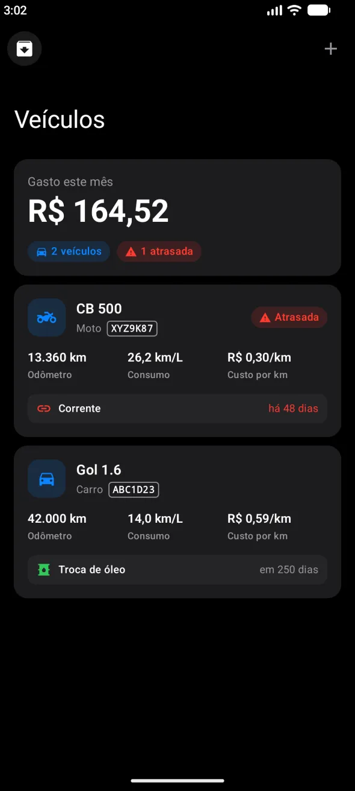
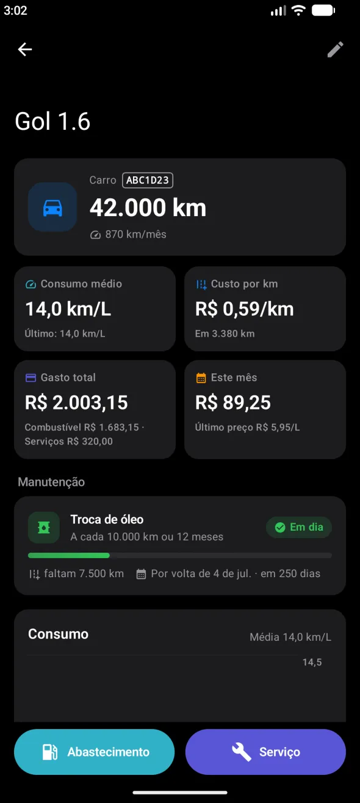
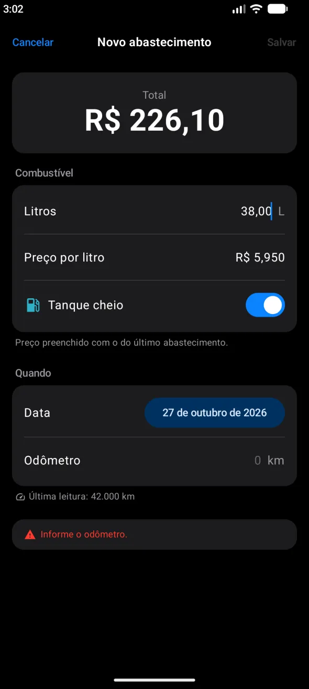
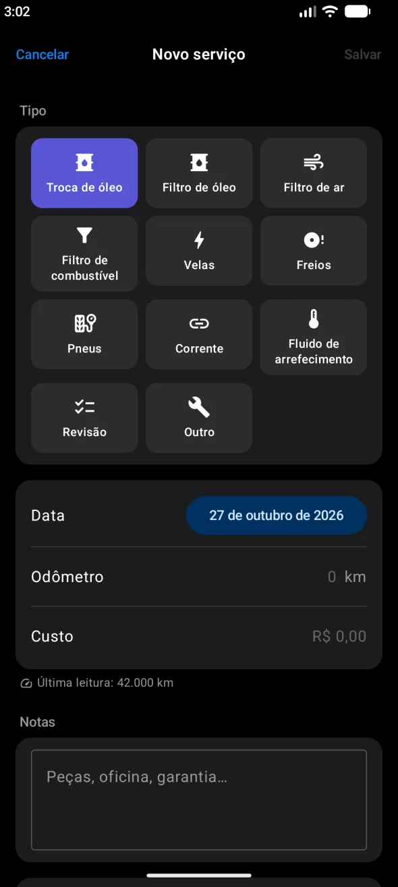
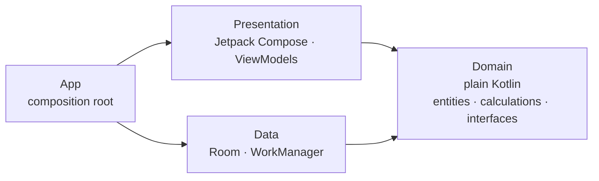

<div align="center">

# Rodaro

**Car and motorcycle maintenance tracker for Android: fuel log, real consumption, cost per km and service reminders.**

[](https://github.com/joaoduartemariucio/kmais-app-android/actions/workflows/ci.yml)


[](LICENSE)

`Clean Architecture` · `MVVM` · `Repository` · `SOLID` · `Dependency Injection` · `Coroutines` · `Jetpack Compose` · `CI` · `AI agents`

The Android twin of [kmais-app-ios](https://github.com/joaoduartemariucio/kmais-app-ios) — same screens, rules, agents and CI gates.

</div>

<p align="center">
  
  
  
  
</p>

## Features

- **Vehicles** — cars and motorcycles, each with its own history and summary card.
- **Fuel log** — record fill-ups; consumption (km/L) is computed per interval between full tanks.
- **Anomaly detection** — flags entries that break the history (odometer going backwards or unchanged, non-positive liters, duplicates) so the stats can explain why a point was left out.
- **Cost** — total spent, fuel vs. service breakdown and cost per km.
- **Maintenance rules** — oil, filters, spark plugs, brakes, tires, chain, coolant, inspection; due by km and/or by time.
- **Forecast** — projects when the next service is due from the vehicle's own km/month pace.
- **Reminders** — notifications at 9:00 on the day a service is due, kept in sync as
  you log fuel-ups and services, edit rules or archive a vehicle.
- **Timeline** — fuel and service entries grouped by month.
- Localized in **English and Portuguese (pt-BR)**, with locale-aware number input and units kept in km and liters.

## Architecture

A pragmatic take on **Clean Architecture**: **MVVM** in the presentation layer, the
**Repository** pattern for persistence and **SOLID** — dependency inversion above all — holding
it together. Three layers live in a single app module, and their boundaries are enforced by a
lint script in CI.



| Layer | May depend on | Never depends on |
|---|---|---|
| `domain` | Kotlin, `java.time`, `java.math` | Android, Jetpack, `data`, `presentation` |
| `data` | `domain`, Room, WorkManager | `presentation` |
| `presentation` | `domain`, Jetpack Compose | `data` |
| `app` | everything | — |

### Patterns and where they live

| Pattern | Role | In the code |
|---|---|---|
| **Clean Architecture** | Business rules at the center, frameworks at the edges | `domain/` is plain Kotlin; Room and Compose stay in `data/` and `presentation/` |
| **MVVM** | Screen state and logic out of the composables | One ViewModel per screen (`VehicleDetailViewModel`, `FuelEntryFormViewModel`, …) with Compose snapshot state |
| **Repository** | Persistence behind an interface | Interfaces in `domain/<feature>/repositories`, Room implementations in `data/<feature>/repositories` |
| **Mapper** | Storage models never leak | `data/<feature>/mappers` turns Room entities into plain domain data classes |
| **Dependency Injection** | One composition root | `app/AppDependencies` is the only place that creates concrete types, provided via `LocalDependencies` |

### SOLID in practice

- **S — Single responsibility:** one ViewModel per screen; calculations split by concern
  (`Consumption`, `Cost`, `Odometer`, `Maintenance`); mapping separated from persistence.
- **O — Open/closed:** new behavior is additive — e.g. reactive reads will be a new
  `observe…(): Flow` repository method, with no existing signature changing.
- **L — Liskov substitution:** in-memory fake repositories replace the Room ones in tests,
  and the ViewModels can't tell the difference.
- **I — Interface segregation:** three small repository interfaces (`VehicleRepository`,
  `FuelEntryRepository`, `ServiceRepository`) instead of one data manager.
- **D — Dependency inversion:** ViewModels and repositories both depend on abstractions owned
  by `domain`; nothing in `domain` knows Room or Compose exist.

### Pragmatic trade-offs

Clean Architecture sized for a one-developer app, on purpose:

- **No use-case layer** — most would be one-line pass-throughs; business rules live in
  `domain/<feature>/calculations` and are tested there.
- **Layers as packages, not modules** — boundaries are guarded by lint instead of the compiler;
  `domain` and `data` become Gradle modules once a second target (widget, Wear OS) needs them.

Each trade-off, with what it costs and when to revisit it, is in [decisions](docs/decisions.md).

### Highlights

- **Pure, deterministic domain.** Consumption, cost, odometer and maintenance forecast are
  pure functions in `domain/<feature>/calculations`. The forecast never reads the clock — the latest
  history point acts as "now", so the same history always yields the same prediction.
- **Money in `BigDecimal`**, never `Double` arithmetic.
- **Room stays behind interfaces.** Repositories map Room entities to plain data classes;
  composables never see a storage type.
- **Same rules as iOS, same tests.** Every Domain and ViewModel test of the iOS app has a
  Kotlin counterpart with the same name and the same cases.
- **Layer boundaries as lint rules.** Importing Android in `domain/`, or referencing a `data`
  type from `presentation/`, fails the build:

```python
("domain_no_android", "domain/**/*.kt", r"^\s*import\s+(android|androidx|com\.google\.android)\.", ...)
```

```
app/src/main/java/br/com/joaoduartemariucio/rodaro/
├── app/            # RodaroApplication, MainActivity, AppDependencies (only place that creates concrete types), navigation/AppNavHost (main host)
├── domain/             # one folder per feature, Clean Architecture folders inside
│   ├── vehicles/
│   │   ├── entities/       # Vehicle, VehicleKind, VehicleRecords, OdometerSample
│   │   ├── repositories/   # VehicleRepository (interface)
│   │   └── calculations/   # Odometer
│   ├── fueling/            # entities/ FuelEntry · repositories/ · calculations/ Consumption, anomalies
│   ├── maintenance/        # entities/ ServiceEntry, ServiceRule, ServiceKind · repositories/ · calculations/ Maintenance
│   ├── costs/              # calculations/ Cost, CostSummary (fuel + services)
│   ├── reminders/          # calculations/ ReminderPlan · services/ ReminderScheduler (interface)
│   └── common/             # calculations/ calendar math, decimals · entities/ · services/ DateProvider · errors/
├── data/
│   ├── vehicles/
│   │   ├── models/         # VehicleModel, VehicleDao
│   │   ├── mappers/        # VehicleMapper
│   │   └── repositories/   # RoomVehicleRepository
│   ├── fueling/            # models/ · mappers/ · repositories/
│   ├── maintenance/        # models/ · mappers/ · repositories/
│   ├── reminders/          # services/ WorkManager scheduler, ReminderWorker, NotificationPermission
│   ├── database/           # RodaroDatabase, Converters
│   └── common/             # repositories/ persisting · services/ SystemDateProvider
└── presentation/
    ├── vehicles/       # VehicleStats (shared by list and detail)
    │   ├── navigation/ # VehiclesRoute + vehiclesEntries
    │   ├── list/       # VehicleListScreen + VehicleListViewModel + components/
    │   ├── detail/     # VehicleDetailScreen + VehicleDetailViewModel + VehicleTimeline + components/
    │   └── form/       # VehicleFormDialog + VehicleFormViewModel + components/
    ├── fueling/form/   # FuelEntryFormDialog + FuelEntryFormViewModel
    ├── maintenance/form/ # ServiceEntryFormDialog + ServiceEntryFormViewModel + components/
    ├── reminders/      # ServiceReminderSync
    ├── common/         # forms, formatting, validation, navigation (Route, Navigator), shared building blocks
    └── theme/
```

Design decisions are written down instead of commented in code:

- [Architecture](docs/architecture.md) — layers, data flow, iOS ⇄ Android map, lint rules and how to add a feature
- [Decisions](docs/decisions.md) — what was chosen, why, and what it costs
- [CI](docs/ci.md) — lint, format, build, test and coverage rules
- [AI agents](docs/agents.md) — the four specialized agents used to build the app, and why

## Testing

Tests use **JUnit 4** with `kotlin.test`:

- `calculations/` — consumption, anomalies, cost, odometer and maintenance forecast with fixtures.
- `viewmodels/` — ViewModels tested against in-memory fake repositories, no Room involved,
  plus the number mask and the pt-BR translations.
- `data/` — Room repositories on an in-memory database and the WorkManager scheduler, with Robolectric.

## CI

Every push and pull request must pass, on GitHub Actions:

| Check | Tool | Rule |
|---|---|---|
| **Lint** | [`scripts/layer_rules.py`](scripts/layer_rules.py) + Android Lint | zero violations, warnings included |
| **Format** | Spotless + ktlint | code matches the `ktlint_official` style |
| **Build** | Gradle `assembleDebug` | app and tests compile |
| **Test** | Gradle `testDebugUnitTest` | every unit test passes |
| **Coverage** | [`scripts/diff_coverage.py`](scripts/diff_coverage.py) + JaCoCo | **≥ 80% of the changed executable lines** are covered |

The coverage gate applies to **new code**: lines added or modified by the change, excluding
pure Compose layout and app wiring. Details, every rule and how to run each check locally are in
[docs/ci.md](docs/ci.md).

## Getting started

Requirements: JDK 17+ and the Android SDK with API 37 (Android Studio installs both).

```bash
git clone https://github.com/joaoduartemariucio/kmais-app-android.git
cd kmais-app-android
./gradlew installDebug
```

Run the same checks as CI before pushing:

```bash
make ci
```

## Roadmap

- Observe data with Room `Flow`s behind the existing repository interfaces, replacing reload-after-write.
- Cloud sync, shared with the iOS app.
- Promote `domain` and `data` to Gradle modules once a second surface (widget, Wear OS) needs them.

## License

[MIT](LICENSE) © João Vitor Duarte Mariucio
