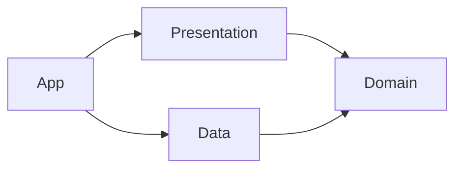

# Architecture

Rodaro follows a pragmatic **Clean Architecture** with **MVVM** for screens, the **Repository**
pattern for persistence and **SOLID** principles — mainly dependency inversion. It is the
same design as [kmais-app-ios](https://github.com/joaoduartemariucio/kmais-app-ios), layer for
layer, with Android's tools in place of Apple's. The
[README](../README.md#patterns-and-where-they-live) maps each pattern and principle to the
code; this document covers how the pieces work.

The app is a single Gradle module split into four packages. The split is by package, not by
module, and the boundaries between them are enforced by `scripts/layer_rules.py` in `make lint`.

| Package | What lives there | May use | Must not use |
|---|---|---|---|
| `domain/` | Entities, calculations, repository and service interfaces, errors | Kotlin stdlib, `java.time`, `java.math` | Android, Jetpack, `data`, `presentation` |
| `data/` | Room entities and DAOs, mappers, repositories, WorkManager scheduler, system clock | `domain`, Room, WorkManager | `presentation` |
| `presentation/` | Composables, ViewModels, form helpers, formatting, localization | `domain`, Jetpack Compose, Android resources | `data` |
| `app/` | `RodaroApplication`, `MainActivity`, `AppDependencies`, `navigation/AppNavHost` | everything | — |

| iOS | Android |
|---|---|
| SwiftUI | Jetpack Compose + Material 3 |
| `@Observable` ViewModel | `ViewModel` with Compose `mutableStateOf` state |
| SwiftData `@Model` / `@ModelActor` | Room `@Entity` / `@Dao` behind `suspend` repositories |
| `NavigationStack(path:)` | Navigation 3 back stack of `Route` values, one sealed set per feature |
| `.sheet` | full-screen `Dialog` (`FormDialog`) |
| `UNUserNotificationCenter` | WorkManager + `NotificationCompat` |
| `Decimal`, `Date`, `Calendar` | `BigDecimal`, `Instant`, `ZoneId` |
| `Localizable.xcstrings` | `values/strings.xml` + `values-pt-rBR/strings.xml` |
| Swift Testing | JUnit 4 + `kotlin.test` + Robolectric |
| SwiftLint custom rules | `scripts/layer_rules.py` + Android Lint |
| SwiftFormat | Spotless + ktlint |
| `xccov` | JaCoCo |

## Domain

Plain data classes and pure functions with no Android dependency, grouped by feature:
`vehicles/`, `fueling/`, `maintenance/`, `costs/`, `reminders/`, and `common/` for what every
feature uses (calendar math, decimals, chronology, `DateProvider`, `RepositoryError`). Inside
each feature the usual folders: `entities/`, `repositories/` (interfaces), `calculations/`,
`services/` (interfaces) and `errors/`, only the ones it needs.

- **Entities** — `Vehicle`, `FuelEntry`, `ServiceEntry`, `ServiceRule`, `OdometerSample`.
- **Calculations** — one object per concern, each with its own tests:
  - `Consumption` — km/L per interval between two full tanks, plus `anomalies(records)`
    (odometer going backwards or unchanged, non-positive liters, duplicates).
  - `Cost` — fuel and service totals, cost per km.
  - `Odometer` — current reading, the full reading history of a vehicle, and
    `neighbors(date, samples)` (the readings right before and after a date).
  - `Maintenance` — km/month pace, next service date and odometer for a rule, and
    `status(due, currentOdometer, now, zone)` (on track / due soon / overdue, with progress).
  - `TripCost` (`trips/`) — fuel cost of a trip: total distance (doubled for a round trip) ÷
    km/L × price per liter, and cost per km.
  - `ReminderPlan` — when to notify for each rule: 9:00 on the due day, or the next 9:00 when overdue.
  - `CalendarMath` — start of day, adding days and months, month start, days between: the
    `Calendar` operations of the iOS code, on `java.time` with an explicit `ZoneId`.
- **Interfaces** — `VehicleRepository`, `FuelEntryRepository`, `ServiceRepository`,
  `DateProvider`, `ReminderScheduler`. Everything `suspend` and returning entities.

Calculations never read the clock: "now" is either passed in or taken from the latest
reading, so the same input always gives the same output.

## Data

Grouped by feature like Domain: `vehicles/`, `fueling/` and `maintenance/` each have
`models/` (Room entities and DAO), `mappers/` and `repositories/`; `reminders/services/` holds
WorkManager; `database/` and `common/` hold what is shared.

- **Room entities** — all suffixed `Model` (the layer rule relies on it), one DAO per feature,
  and `RodaroDatabase` in `database/`. Each record belongs to a vehicle through a foreign key with
  `ON DELETE CASCADE`; ids are UUIDs stored as text and money is stored as a decimal string.
  The schema is exported to `app/schemas/` so migrations can be checked.
- **Mappers** — Room model ⇄ entity, in both directions.
- **Repositories** — one Room repository per interface. Every call goes through `persisting`,
  which wraps storage exceptions in `RepositoryError.PersistenceFailed` and lets domain errors
  and cancellation through.
- **Services** — `SystemDateProvider` (`common/`), `WorkManagerReminderScheduler`, `ReminderWorker` (posts
  the notification) and `NotificationPermission` (bridges the runtime permission to the activity).

## Presentation

One ViewModel per screen, depending only on Domain interfaces. Each screen has its own
package — composable, ViewModel and a `components/` folder for the pieces only it uses (see
[decisions](decisions.md#one-folder-per-screen-in-presentation)). State is Compose snapshot
state (`mutableStateOf`), so derived values (`issues`, `canSave`, `totalCost`, …) are plain
getters, exactly like computed properties on an `@Observable`.

- **Lists and detail** load in a `LaunchedEffect` and reload after each write. Their
  ViewModels live in the Navigation 3 entry, so they survive configuration changes.
- **Forms** (`VehicleForm`, `FuelEntryForm`, `ServiceEntryForm`) follow the same shape:
  - fields kept as `String` so "empty" and "zero" are different states;
  - `issues: List<ValidationIssue>` computed from the fields. Issues are either **blocking**
    (red, disable Save) or **warnings** (orange, informative only);
  - `FormState` (`Editing`, `Saving`, `Saved`, `Failed`) drives the top bar.
- **Common helpers**:
  - `LabeledNumberField` + `NumberInput.Style` — masked numeric input (see
    [decisions](decisions.md#numeric-fields-are-digit-shifting-masks)).
  - `ValidationFooter` — renders issues with the right color and icon.
  - `FormatStyles` — km, liters, km/L, currency and date formatting for display.
  - `Localizer` — localized strings for code outside composables (ViewModels' helpers and
    reminder text), backed by Android resources in the app and by `strings.xml` in tests.
  - `Palette` — category colors (fuel, service) and status colors, labels and icons.
  - `SymbolBadge`, `MetricTileCard`, `StatusCapsule`, `ProgressBar` — shared building blocks
    of the dashboard cards.
  - `Modifier.dismissesKeyboard()` — tap outside, scroll or "Done" closes the keyboard.
- **Vehicle dashboard** — `VehicleStats` gathers everything a card shows (consumption history,
  km/L per closing fill-up, this month's spending, every reminder with its status);
  `VehicleTimeline` groups the history by month, filters it and builds the spending chart data.
  Charts are drawn with Compose `Canvas` (`vehicles/detail/components/Charts.kt`).
- **Reminders** — `ServiceReminderSync` re-plans service notifications at the end of the
  list and detail `load()`: it gathers each active vehicle's records, asks
  `ReminderPlan.reminders(records, now, zone)` (Domain) when each rule is due, cancels stale
  notifications and schedules the rest through `ReminderScheduler`. See
  [decisions](decisions.md#reminders).

## App

### Navigation

One main host, and each feature owns its own routes and entries:

- `presentation/common/navigation/` — `Route` (marker every destination implements) and
  `Navigator`, which keeps one back stack per tab. The stack `NavDisplay` sees is the start
  tab's stack, plus the current tab's when it is another one, so Back on another tab's root
  returns to the start tab. `open(route)` ignores a second tap on the same destination,
  `back()` never empties the start tab, and tapping the current tab pops it to its root.
- `presentation/<feature>/navigation/` — the feature's `…Route` sealed interface and a
  `…Entries(navigator)` extension on `EntryProviderScope<Route>` that maps each route to its
  screen. Vehicles: `VehiclesRoute` (`VehicleList`, `ArchivedVehicles`, `VehicleDetail`) in
  `vehiclesEntries`; Trips: `TripsRoute.TripCost` in `tripsEntries`; Profile: `ProfileRoute.Profile`
  and `ProfileRoute.Auth` in `profileEntries`. Forms stay dialogs
  opened by their screen, not destinations.
- `app/navigation/AppNavHost` — the main and only `NavDisplay`, inside a `Scaffold` with the
  bottom bar. It lists the tabs (Vehicles, Archived, Route, Profile), adds each feature's entries and
  sets the transitions: slide for push and pop inside a tab, instant for a tab switch.

Screens never see routes: they take callbacks (`onOpenVehicle`, `onBack`)
and the feature's entries turn them into `Navigator` calls. A new screen in a feature means a
new case in its `…Route` and one `entry<…>` in its `…Entries`; a new feature with screens adds
its own `navigation/` folder and one line in `AppNavHost`, plus a `Tab` if it is top level.

### Firebase

`FirebaseSetup` (`app/`) starts Crashlytics, Remote Config, the push channel and AdMob when
the application starts — the ad SDK, the first interstitial and the first app-open ad.
`AppDependencies.analytics` is the only way the rest of the app reaches
Analytics, and `AppNavHost` uses it to log screen views. Details and versions are in
[decisions](decisions.md#android-firebase-and-admob).

Authentication lives behind the Domain `AccountService`: `AppDependencies.accountService` is a
`FirebaseAccountService` (Data) covering e-mail/password and Google sign-in, and
`AppDependencies.clearLocalData` is the wipe that account deletion runs after the Firebase
account is gone. See [decisions](decisions.md#android-firebase-authentication-and-account-deletion).

### Dependencies

`AppDependencies` is the only place that creates concrete types. It is provided to the
composition through `LocalDependencies` and has three flavors: `live(context)`,
`inMemory(context)` for tests and fallbacks, and `preview(context)` seeded with `PreviewData`.
If the on-disk database cannot be opened, `live` falls back to memory and sets
`isUsingFallbackStore`.

## Data flow

**Read:** screen appears → ViewModel calls repository interfaces → repository queries Room
and maps models to entities → ViewModel runs Domain calculations (`VehicleStats`,
`VehicleTimeline`) and publishes state.

**Write:** form builds an entity → repository upserts the model → dialog dismisses → parent
ViewModel reloads.

## Enforcement

`scripts/layer_rules.py` runs first in `make lint`; every rule is an error:

| Rule | Fails when |
|---|---|
| `domain_no_android` | a file in `domain/` imports `android.*`, `androidx.*` or `com.google.android.*` |
| `domain_no_outer_layers` | a file in `domain/` imports from `data`, `presentation` or `app` |
| `presentation_no_data_types` | a file in `presentation/` imports from `data` or mentions a Data type (`VehicleModel`, `RodaroDatabase`, `Room…Repository`, `WorkManager…`, …) |

Comments and string literals are ignored. The Domain rules are exact (they match real
imports). The Presentation rule also matches names, so **a new Room entity must be added to
its list**. Android Lint then runs with warnings as errors. See [CI](ci.md).

## Tests

JUnit 4, in `app/src/test/`:

- `calculations/` — every Domain calculation, with shared fixtures (`day(_)`, `sample(_, _)`, …).
- `viewmodels/` — ViewModels against in-memory fakes (`fakes/InMemoryRepositories.kt`,
  `FixedDateProvider`, `TestLocalizer`), plus the number mask and the string resources.
- `data/` — Room repositories on an in-memory database and the WorkManager scheduler, under Robolectric.

## Adding a feature

1. **Domain:** in the feature's folder, add or extend the entity (`entities/`) and write the calculation as a pure function, with tests.
2. **Domain:** if it needs storage, add the method to the repository interface.
3. **Data:** implement it in the Room repository; a new entity goes in `RodaroDatabase`
   **and** in the `presentation_no_data_types` rule; bump the version and add a migration.
4. **Presentation:** ViewModel talks to the interface; test it with the in-memory fakes.
5. **App:** only touch `AppDependencies` if a new concrete type is needed.
6. Add user-facing strings to `values/strings.xml` and `values-pt-rBR/strings.xml`.
