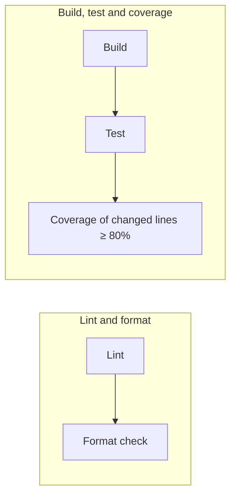

# CI

Every push and pull request runs [`.github/workflows/ci.yml`](../.github/workflows/ci.yml) on
GitHub Actions (`ubuntu-latest`, JDK 17, Gradle with build cache). A change is mergeable only
when every check below passes. The gates are the same as in
[kmais-app-ios](https://github.com/joaoduartemariucio/kmais-app-ios); only the tools differ.



The two jobs run in parallel. A newer push to the same branch cancels the run in progress.

## Rules

| Check | Command | Fails when |
|---|---|---|
| **Lint** | `make lint` | a layer rule is broken, or Android Lint reports anything (warnings are errors) |
| **Format** | `make format-check` | any file differs from what ktlint would produce |
| **Build** | `make build` | the app or the unit tests do not compile |
| **Test** | `make test` | any unit test fails |
| **Coverage** | `make coverage` | less than **80%** of the changed executable lines are covered by tests |

### Lint — layer rules and Android Lint

[`scripts/layer_rules.py`](../scripts/layer_rules.py) holds the three rules that keep the layers apart:

| Rule | Fails when |
|---|---|
| `domain_no_android` | a file in `domain/` imports Android or Jetpack |
| `domain_no_outer_layers` | a file in `domain/` imports from `data`, `presentation` or `app` |
| `presentation_no_data_types` | a file in `presentation/` mentions a Data type |

Android Lint runs next (`lintDebug`, `warningsAsErrors = true`). Only the checks that report
newer library versions are turned off: dependency updates are a deliberate change, not a
lint failure. CI uploads the HTML report.

### Format — Spotless + ktlint

Config: the `spotless` block in [`build.gradle.kts`](../build.gradle.kts).
[ktlint](https://pinterest.github.io/ktlint/)'s `ktlint_official` style — the community
baseline for Kotlin — with a few options pinned:

| Option | Value | Why |
|---|---|---|
| Max line length | 140 | Compose call chains get long; off for tests, whose names are sentences |
| `package-name` | off | the namespace `kmais_app_android` comes from the project template |
| `function-naming` | Composables may be PascalCase; off for tests (backtick names) | |
| `property-naming`, `backing-property-naming` | off | Compose state and `R` constants clash with them |

Run `make format` to fix everything at once.

### Build and test

`make build` compiles the debug app and the unit tests; `make test` runs every unit test,
Robolectric included, with JaCoCo instrumentation and writes
`app/build/reports/coverage/test/debug/report.xml`. CI uploads the test and coverage reports,
so a failure can be opened in a browser.

Instrumented (emulator) tests are not part of CI.

### Coverage of changed lines

The rule is about **new code**, not the whole project: of the executable lines added or
modified by the change, at least **80%** must run during the tests.

[`scripts/diff_coverage.py`](../scripts/diff_coverage.py):

1. diffs the change against its base, ignoring whitespace-only edits:
   - **pull request** → the PR's base commit;
   - **push** → the commit the branch was at before the push (`origin/main` for a new branch);
   - **locally** → `origin/main`, including uncommitted edits; files not yet added to git count in full;
2. reads per-line execution counts from the JaCoCo XML report;
3. keeps only executable lines (comments, braces and declarations never count) in files not
   listed in [`.coverageignore`](../.coverageignore);
4. fails if covered / executable < 80%, printing every uncovered line. In CI the same table
   appears in the run's summary.

A change with no executable lines (docs, composables only, config) passes automatically.

#### What does not count

[`.coverageignore`](../.coverageignore) lists code with no logic of its own, which unit tests
can't meaningfully exercise:

- `app/` — entry point and composition root;
- Compose screens, dialogs, rows, cards and charts (`*Screen.kt`, `*Dialog.kt`, `*Row.kt`,
  `*Card.kt`, `Charts.kt` and a few common components) and the theme;
- `KeyboardDismissal.kt` and `Localizer.kt` — Android glue;
- `data/PreviewData.kt` — preview and seed fixtures.

**ViewModels, `domain` and `data` always count.** Logic in a composable belongs in its
ViewModel, where it can be tested. A new Room repository needs tests against an in-memory
database.

## Running it locally

```bash
make ci
```

`make ci` runs the same steps as CI in order. Each one also runs on its own:

| Command | What it does |
|---|---|
| `make lint` | layer rules, then Android Lint |
| `make format` | formats the code in place |
| `make format-check` | fails if anything would be reformatted |
| `make build` | builds the app and the unit tests |
| `make test` | runs the unit tests with coverage |
| `make coverage` | checks changed lines against `origin/main`; `BASE=<ref>` or `MIN_COVERAGE=<n>` to override |
| `make clean` | removes build output |
